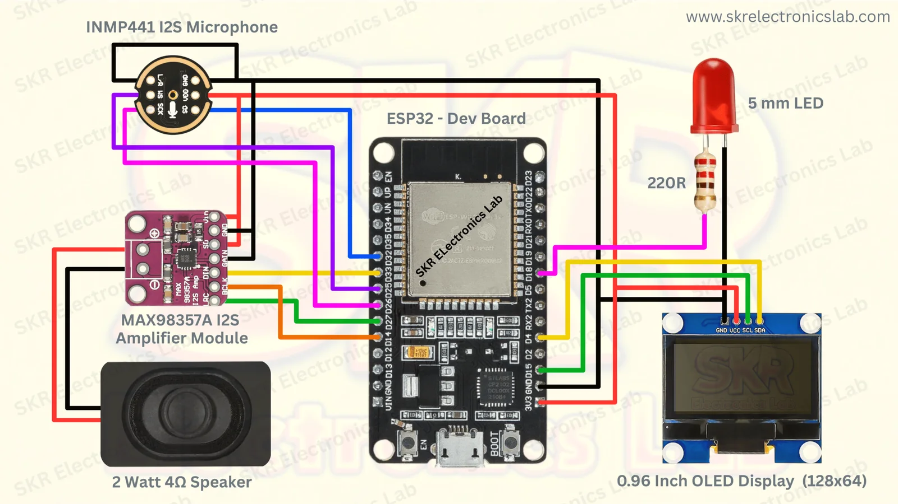

# 🤖 Xiaozhi AI Voice Assistant using ESP32

This project demonstrates how to build an ESP32-based AI voice assistant capable of real-time voice conversations using the Xiaozhi AI platform. It integrates an I2S microphone, I2S audio amplifier, OLED display, and Wi-Fi connectivity to provide a compact, interactive AI experience.

The goal of this project is to provide an affordable, open, and easily reproducible AI assistant that hobbyists and students can build using commonly available ESP32 hardware. This repository documents the complete hardware setup, firmware flashing process, wiring, and future enhancements.
jj
## Featuresfmm

- ✅ Real-time AI conversations
- ✅ Wi-Fi connectivity
- ✅ OLED status display
- ✅ I2S microphone support
- ✅ I2S speaker output
- ✅ Easy firmware installation
- ✅ ESP32 based
- ✅ Open hardware setup

| Component    | Purpose         |
| ------------ | --------------- |
| ESP32 DevKit | Main Controller |
| INMP441      | Voice Input     |
| MAX98357A    | Audio Output    |
| OLED Display | Status Display  |
| Speaker      | AI Responses    |

VCC → 3.3V
The firmware used in this project was flashed using the Xiaozhi AI Firmware Flasher developed by SKR Electronics Lab. This tool provides an easy deployment process without requiring users to manually compile the firmware.

Acknowledgements

Special thanks to SKR Electronics Lab for developing the Xiaozhi AI Firmware Flasher. Their work greatly simplified the deployment process and made this project accessible to beginners.

Acknowledgements

Special thanks to SKR Electronics Lab for developing the Xiaozhi AI Firmware Flasher. Their work greatly simplified the deployment process and made this project accessible to beginners.

## Hardware

## Wiring Diagram

## Demo

